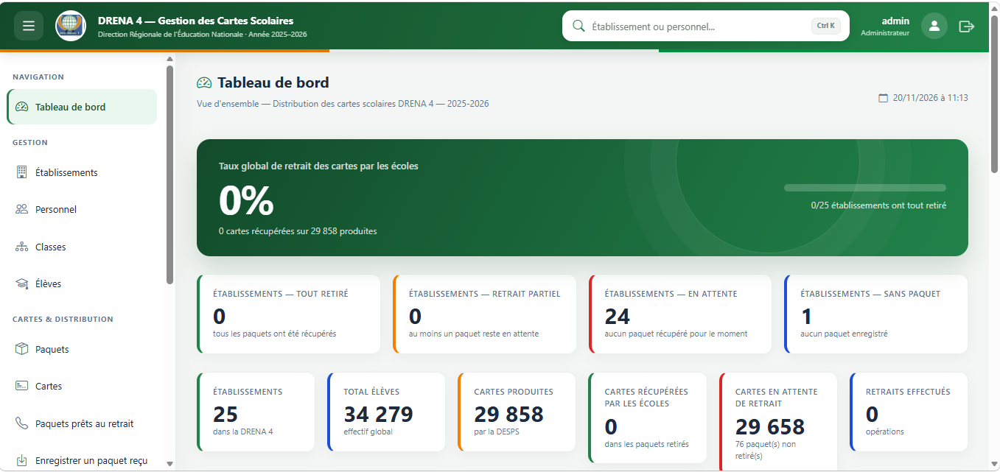
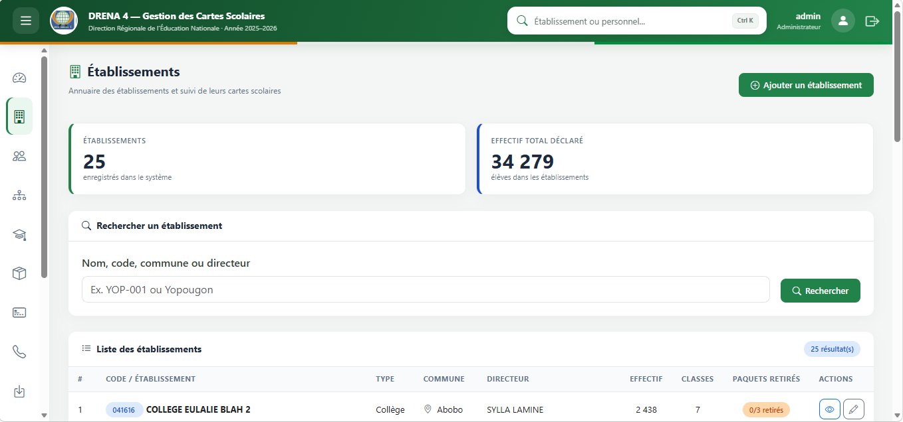
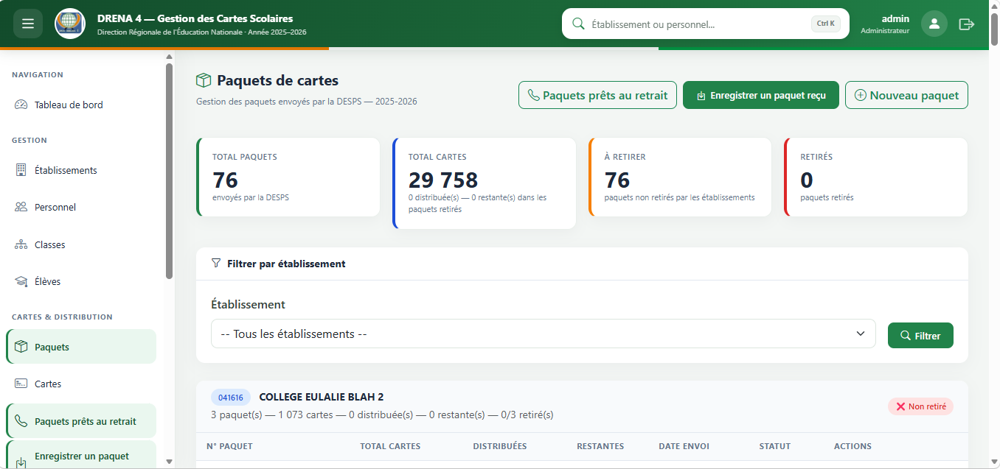
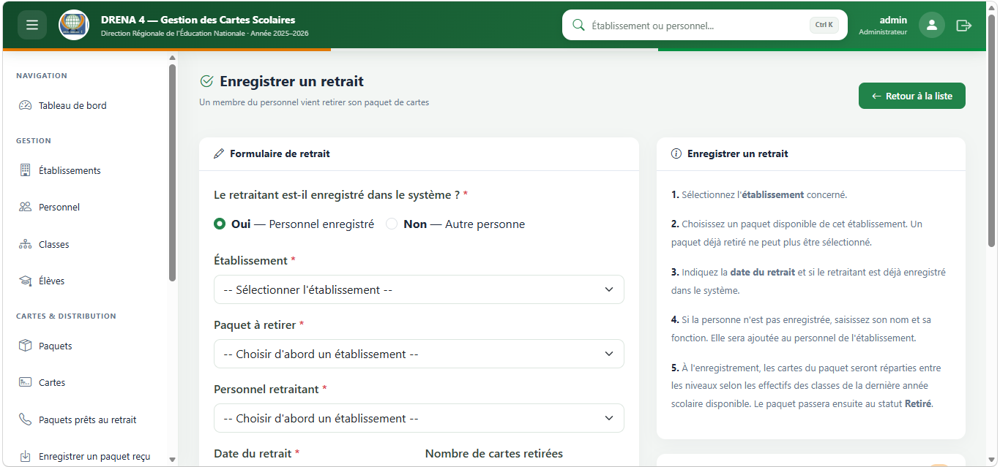
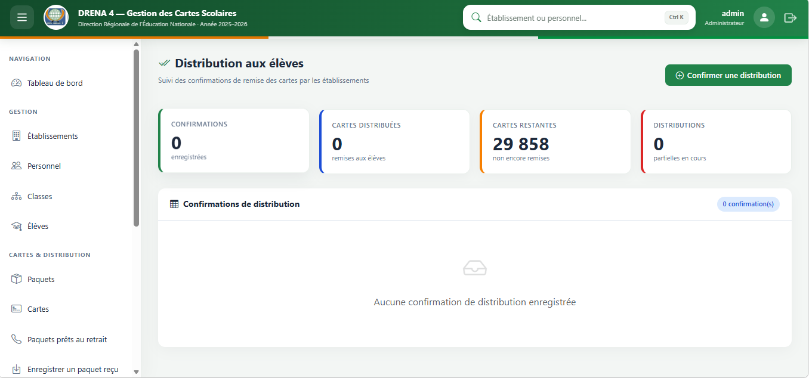
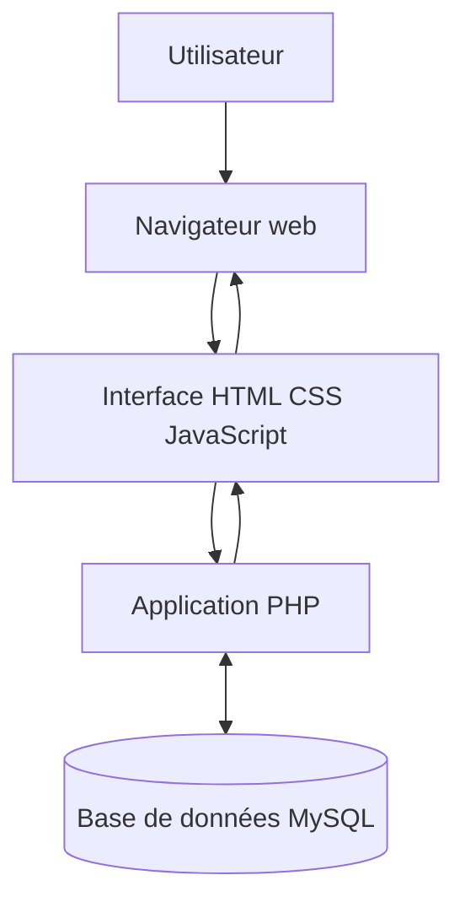

# DRENA4 – Gestion de la distribution des cartes d'identité scolaires

### Présentation

Application web conçue et développée par mes soins dans le cadre de mon stage en informatique à la DRENA4 (Abidjan 4).

Elle facilite la gestion et le suivi de la distribution des cartes d'identité scolaires aux établissements.

### Fonctionnalités

- Gestion des établissements, classes et élèves.
- Gestion des paquets de cartes.
- Enregistrement des retraits.
- Suivi de la distribution des cartes aux élèves.

### Technologies

PHP • MySQL • HTML5 • CSS3 • JavaScript • Bootstrap 5

### Conception

Méthode MERISE.

### Environnement

WAMPServer • Visual Studio Code • phpMyAdmin

### État du projet

Application fonctionnelle en environnement local.

### Auteur

Othniel Djevie

Projet réalisé dans le cadre d'un stage en informatique à la DRENA4.

---

*Le code source et les données de l'application ne sont pas publiés dans ce dépôt.*

## Aperçu de l’application

### 1. Tableau de bord

### 2. Gestion des établissements

### 3. Gestion des paquets

### 4. Gestion des retraits

### 5. Suivi de la distribution

## Fonctionnement de l'application

L'application est organisée autour de cinq principaux modules :

**1. Tableau de bord**
Permet de consulter une vue globale des activités et des statistiques liées à la distribution des cartes scolaires.

**2. Gestion des établissements**
Permet d'enregistrer et de gérer les établissements concernés par la distribution.

**3. Gestion des paquets**
Permet d'assurer le suivi des paquets de cartes reçus et destinés aux établissements.

**4. Gestion des retraits**
Permet d'enregistrer les retraits de paquets effectués par les représentants des établissements.

**5. Suivi de la distribution**
Permet de suivre la distribution des cartes aux élèves et de consulter leur statut.

## Architecture de l'application

